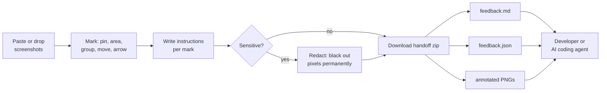

# SSMD: screenshot markup

[](https://github.com/AaryanRaj007/ssmd/actions/workflows/test.yml)
[](LICENSE)

A local, no-server tool for telling a developer, or an AI coding agent, exactly what to change on a screen. Drop or paste screenshots, mark pins, areas, groups, moves and arrows, write instructions, then download a handoff zip containing `feedback.md`, `feedback.json` and annotated PNGs.

**Run it:** open `index.html` in a browser. There's no build step and no dependencies.

## How it works



## Features

- **Marks:** pins, areas, groups, moves and arrows. Without a pointer, use Instruction editor › Target details › Add by coordinates, then edit the numeric fields.
- **Copy changes:** `Replacement text:` is always exported; empty means delete the text, written as `""`. `Current text:` is left out when blank, meaning unknown.
- **Tabs:** ＋ New adds screenshots and × closes one (Undo restores it). "Include as reference" sends a screenshot with no instructions.
- **Undo/redo:** ⌘/Ctrl+Z, ⌘/Ctrl+Shift+Z or Ctrl+Y, covering the last 60 steps of the session. They aren't kept across a reload, and Undo never throws away an unsaved draft.
- **Autosave:** to this browser's IndexedDB. Project › Save editable project gives you a portable copy.
- **Safe Markdown:** your text is treated as data. `[ ] < `` are escaped, so links, images, HTML and code fences stay literal.
- **Touch:** pan a zoomed screenshot with two fingers.

## Privacy

Nothing is uploaded. The app contains no network code.

Without redaction, handoff PNGs and project files contain the full screenshot pixels. The **Redact** tool (R) blacks out an area of the screenshot itself, and Undo cannot restore it. Redaction covers:

- that screenshot and identical copies in the open workspace
- the stored workspace
- every export and project saved afterwards

It doesn't change files you already downloaded, other open tabs (they're told to reload), the original image files, clipboard contents or typed text. The app confirms a save has finished before saying it's saved; if a save fails, the status says an older copy remains.

With several tabs open, the first tab to save wins. A stale tab stops autosaving and says so. It can still save an editable project, and reloading it lets you continue.

## Limits

| Limit | Value |
|---|---|
| Pixels per side | 16,000 px |
| Per screenshot | 48 MP |
| Whole workspace | 96 MP (about 384 MB decoded) |
| Screenshots | 30 |
| File size | 20 MB each |

## Testing

Requires Node 20 or newer. Run from the repo root:

```bash
node --test test/core.test.mjs                 # core logic, no dependencies (runs in CI)
SSMD_PW=<dir with node_modules/patchright> node --test test/app.test.mjs   # browser regressions
```

The browser tests use Playwright if it's installed and skip when no browser library is available. Pass file paths, not the `test/` directory.

## Licence

[MIT](LICENSE)
